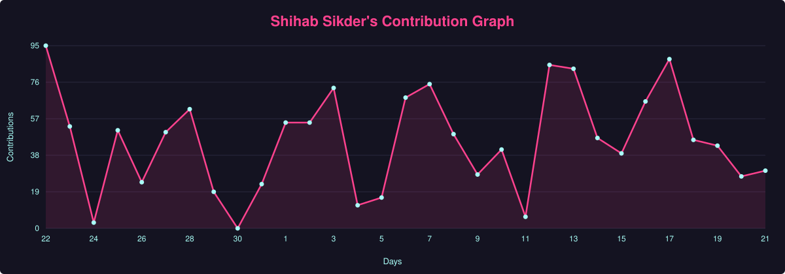

# Shihab Sikder

**AI/ML Engineer · Data Pipeline Architect · Full-Stack Developer**

Dhaka, Bangladesh · [tronics.dev](https://tronics.dev) · [contact@tronics.dev](mailto:contact@tronics.dev) · [LinkedIn](https://linkedin.com/in/shihab-sikder)

---

## About

I build data and AI infrastructure for high-stakes domains: nuclear regulation and public healthcare.

- **Founding Software Engineer at [Everstar](https://everstar.ai).** I architect and run the data pipelines behind Gordian AI, which has processed 3M+ NRC regulatory documents through parsing, ETL and retrieval-augmented generation. The goal is to make nuclear power faster and safer to build.
- **Tech Lead at [BinduLogic](https://bindulogic.com).** I lead deployment of hospital systems (HMS, LIS, RIS/PACS, e-ticketing) at 14+ facilities, including DMCH, CMCH, national medical institutes and military hospitals, serving 2M+ patients across Bangladesh.

**Education:** B.Sc. in Computer Science & Engineering, Islamic University of Technology (IUT) 
**Recognition:** IBM Cybersecurity Analyst · 1st place, National Cyber Drill 2022 · Top Rated on Upwork

---

## Tech Stack

| Area | Tools |
| :--- | :--- |
| **Backend & Data** | Python, Node.js, TypeScript, PostgreSQL, MongoDB, Apache Airflow, vector databases, ETL, Express, Flask, Django |
| **DevOps & Cloud** | Docker, Kubernetes, Terraform, Ansible, AWS, GCP, GitHub Actions |
| **AI/ML** | RAG, GraphRAG, LLMs, NLP, computer vision |
| **Security & Compliance** | Encryption, access control, HIPAA-aligned systems, CTF and security analysis |
| **Frontend** | React, Next.js, Redux Toolkit, Tailwind CSS |

---

## Featured Projects

<table>
<tr>
<td width="50%" valign="top">

### [Gordian AI](https://everstar.ai)
**Nuclear regulatory intelligence · Everstar**

Compliance assistant grounded in 3M+ NRC regulatory documents. Large-scale parsing and ETL pipelines feed a RAG system built for accurate, cited answers.

Next.js · Python · RAG · GraphRAG · Vector DBs · Airflow

</td>
<td width="50%" valign="top">

### [BinduLogic Hospital Systems](https://bindulogic.com)
**Enterprise healthcare platform**

HMS, LIS, RIS/PACS, e-ticketing and inventory systems running at 14+ facilities, including DMCH and CMCH, serving 2M+ patients.

React · Node.js · TypeScript · PostgreSQL · OpenMRS

</td>
</tr>
<tr>
<td width="50%" valign="top">

### [Temp-Mail.lol](https://temp-mail.lol)
**Disposable email service**

Private temporary inboxes with real-time delivery, custom usernames and attachments. 50K+ active users, rated 4.8★ across 1.2K+ reviews.

React · Node.js · PostgreSQL · WebSocket · PWA

</td>
<td width="50%" valign="top">

### [AlgoSketch](https://github.com/arctronic/algosketch)
**Algorithm visualizer**

Interactive animations of 5 sorting and 3 pathfinding algorithms, with speed control and step-by-step execution.

C++ · SFML · CMake

</td>
</tr>
</table>

---

## GitHub Activity

---

## Get in Touch

Open to consulting and collaboration on data, AI and infrastructure work.

